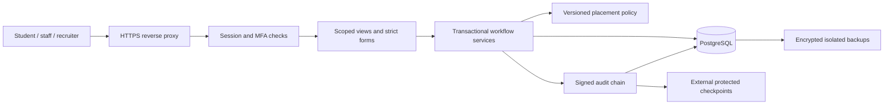

# NFSU Placement System Architecture

The application is a modular Django monolith. Keeping authentication, policy checks, persistence and HTML rendering in one application allows server-side authorization to govern every workflow. PostgreSQL serializes student selection changes; a shared audit-head lock serializes signed audit events.

## Request flow

`placement.access` defines authorized querysets. `placement.forms` validates fields and rejects extra business fields. `placement.services` controls application approval, offer verification, acceptance and sanctions. `placement.policy` returns an outcome, reason codes, explanations and policy version. Reporting operates only on the caller's authorized student queryset.

Views render HTML forms with CSRF tokens; there is no public JSON mutation API. `/health/` returns only database availability. UUID student and offer identifiers reduce accidental enumeration but never replace ownership checks.

## Database relationships

| Entity | Purpose and relationships |
| --- | --- |
| User | Custom identity, role, course/company scope, approval, encrypted email/MFA secret, session revocation version |
| Student | Unique Placement ID, programme/batch, encrypted contact fields, verified registration/eligibility, optional one-to-one account |
| SignupRequest and Token | Unapproved registration claims; hashed, expiring, single-use verification, invitation and recovery tokens |
| Company and Drive | Recruiting organization, I/F/IF type, encrypted compensation, course criteria and schedule |
| Application | Unique student/drive participation, approval state and policy snapshot |
| Offer | Historical selection, verification, acceptance, deadline, withdrawal, stipend, annual CTC, PPO, joining and NOC |
| Attendance and Review | Recruitment activity attendance and authorized review decisions |
| Sanction | Approved absence review linked to three explicit eligible drives |
| Policy and ExceptionGrant | Versioned salary thresholds and drive-specific, expiring administrator exceptions |
| AuditEvent and AuditHead | Signed chronological events and transactional chain head |
| ImportBatch | Encrypted import preview, owner, expiration and single-use commit state |
| Throttle | Hashed authentication rate-limit identifiers with database-backed counters |

Offer history uses protected foreign keys. One application and one offer per student/campus drive are database constraints. A withdrawn offer remains in history; reactivation requires a fresh reviewed offer outside the already recorded drive. Archive disables the linked student account without deleting outcomes.

Annual CTC is an encrypted decimal string in LPA. Internship stipend is an encrypted decimal string in INR with a separate payment period. Forms enforce finite, bounded decimals; policy and reporting use `Decimal`, never floating-point arithmetic.

## Permission matrix

| Capability | Administrator | Officer | Coordinator | Recruiter | Student |
| --- | --- | --- | --- | --- | --- |
| Student records and contacts | All | All | Assigned courses | Approved company applicants | Own |
| Create and update verified student records | Yes | Yes | Assigned courses | No | No |
| Create companies and drives | Yes | Yes | No | No | No |
| Apply to drives | No | No | No | No | Own, if allowed |
| Approve applications and verify offers | Yes | Yes | Assigned courses | No | No |
| Submit unverified offers | Yes | Yes | Assigned courses | Approved own-drive applicants | Own off-campus reports |
| Accept or decline offers | No | No | No | No | Own verified offers |
| Read offer history and compensation | All | All | Assigned courses | Own company | Own |
| Attendance and review decisions | All | All | Assigned courses | No | Submit own review requests |
| Issue three-drive sanctions | Yes | No | No | No | No |
| Export/import/report | All authorized records | All authorized records | Assigned courses | No | No |
| Accounts, policy versions, exceptions and audit trail | Yes | No | No | No | No |

Exports, account authorization changes, invitations and policy exceptions require identity verification within the last five minutes. Staff accounts require MFA. Company applicant access begins only after staff approval.

## Reporting definitions

A placed student has at least one accepted, verified, non-withdrawn offer. Unique placed students differ from total verified offer events. Multiple accepted offers contribute separately to FTE compensation statistics; their student contributes only once to the placement count. Internship-only, FTE-only and combined outcomes derive from accepted offer types.

Highest, mean and median annual CTC exclude internship-only offers, unverified selections, declined/expired/pending offers and withdrawals. Stipends retain their payment periods and are never annualized into CTC. Reports filter by course and batch and include live policy evaluation for upcoming drives.
